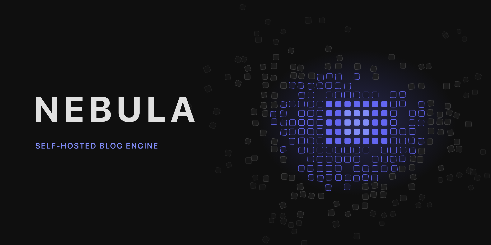
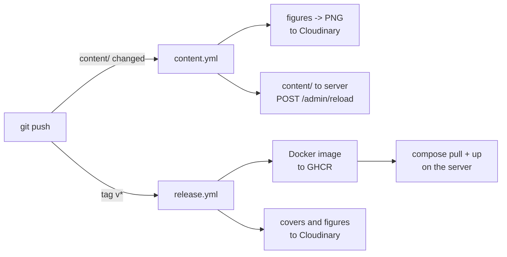
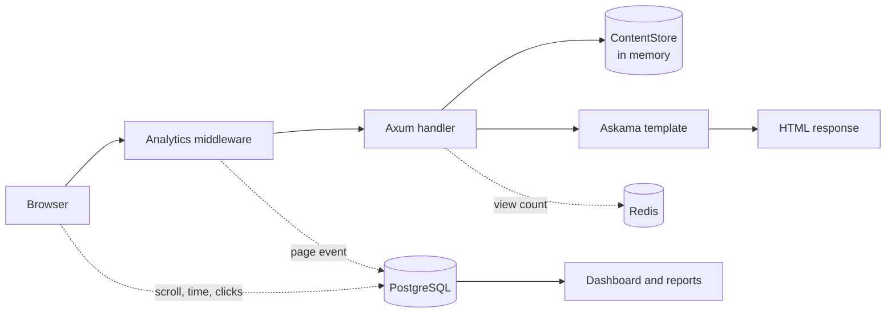

Nebula is a self-hosted blog engine written in Rust. Posts and projects are
Markdown files in a git repository. The server keeps them in memory and renders
pages on request. Analytics are built in, so the site loads no third-party
scripts.

## What it gives

- **Publishing is a git push.** A change under `content/` is copied to the
  server and reloaded in place. Nothing is rebuilt or restarted.
- **A figure is written once.** Figures are inline SVG in the post and follow
  the site's theme. Feed readers and dev.to strip inline SVG and styles, so CI
  renders every figure to PNG in a dark and a light palette. The RSS feed links
  the light set, and `scripts/export-devto.mjs` turns a post into dev.to
  Markdown.
- **Analytics without trackers.** Page views are recorded on the server. A
  small script reports scroll depth, time in view and outbound clicks. Bots are
  filtered out, IP addresses are kept only as daily hashes, and the owner's own
  visits are not counted. Readers whose blockers stop the script still show up
  as "unconfirmed". The dashboard has sources, countries, reading depth and a
  funnel per post, and reports can be sent by email.
- **Links that preview well.** Open Graph and Twitter Card tags carry a PNG
  cover. RSS, a sitemap and canonical URLs are generated.
- **Fast first paint.** Critical CSS is inlined and the rest is deferred. HTMX
  loads from one of three CDNs; Mermaid loads only on pages that have a diagram.
- **A contact form** that sends mail through Resend, with optional Cloudflare
  Turnstile, and **view counters** on posts when Redis is available.

## How it works

Content and code are published separately. A push that touches `content/`
updates the running site; a version tag ships a new image.



A page request never waits on PostgreSQL. Posts come from memory, and the
page event is written by a background task after the response is built.



## Quick start

```bash
docker compose up -d    # PostgreSQL and Redis
cp .env.example .env
cargo run               # http://localhost:3000
```

## Documentation

| Document | What it covers |
|----------|----------------|
| [Architecture](docs/ARCHITECTURE.md) | Stack, modules, request path, content store, images, feeds |
| [Development](docs/DEVELOPMENT.md) | Local setup, configuration, checks, CI, releases, deployment |
| [Content Guide](docs/CONTENT_GUIDE.md) | Writing posts and projects, frontmatter, covers, figures |
| [Visual Style](docs/VISUAL_STYLE.md) | How covers and in-article figures are drawn |
| [Analytics](docs/ANALYTICS.md) | What is recorded, privacy, dashboard, reports |
| [Mermaid Export](docs/MERMAID_EXPORT.md) | Exporting diagrams to PNG for platforms without Mermaid |

## License

MIT
